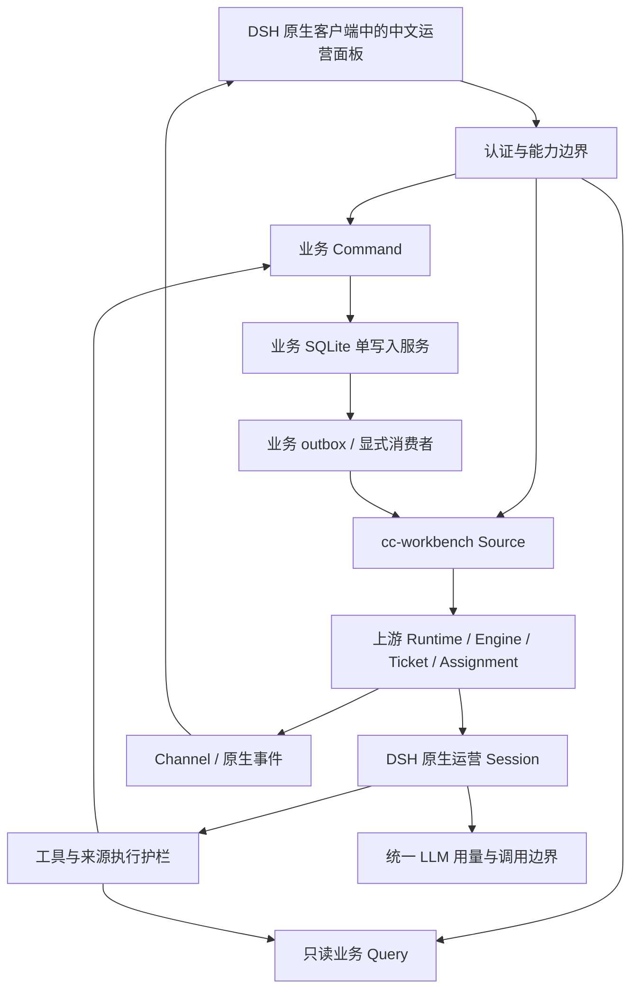

# SuperAgent 原生运营架构

版本 0.1.0｜前置设计，尚未运行。

## 决策

采用固定提交的 SuperAgent 受控适配版作为真实编排底座，DSH 原生 profile/bundle 提供宿主、Agent、会话、模型、压缩、工具与客户端扩展。cc 能力作为业务服务和插件加载。保留 Runtime/Engine/Store/Effects/Ticket/Assignment 的实际实现；不另造 Agent loop，不保留旧 SDK 子进程桥接作为正式宿主。

## 逻辑插件及依赖

| 逻辑模块 | 职责 | 允许依赖 |
| --- | --- | --- |
| superagent-integration | 加载适配版 Runtime；固定补丁、原生角色和版本探针 | 上游 extension exports、contracts、storage-policy |
| workbench-source | 认证请求→Trigger/Thread、事件游标、Channel 回传、业务引用绑定 | 上游 SourceHost、contracts、业务事件只读查询 |
| operations | Task、日历、活动、笔记命令与查询 | contracts、单写业务存储；不依赖 learning 实现 |
| analysis | CSV、预测、库存、分配、发货、广告计算和版本 | contracts、存储；纯计算无模型/网络依赖 |
| learning | 捕获/归并、确认事实/纠正、摘要、成功流程和撤销 | contracts、存储、已提交业务事件 |
| agent-tools | 现有 9 个工具及 cc-approved Provider 的原生装配 | 应用服务接口、认证上下文、单调执行 guard |
| workbench-client | 中文页面、领域 DTO、原生流式和工单状态 | contracts、受认证 Remote；不导入服务实现或持久化类 |
| contracts / storage-policy | schema/DTO、幂等/CAS、隐私/恢复、模型账本 | 最小基础库；业务规则不反向注入 UI |

这些是职责边界，不是要求现在创建 8 个空包。物理包在 P0 原生兼容性验证后按依赖收敛；业务库写入只有一个持久化服务，多个领域通过应用服务调用它，不直接写编排库或原生日志。

## 交互选择

普通表单、导入预览、笔记和确定性计算直接调用业务 Command/Query，模型离线不受影响。自然语言工作由 Source 接收，经过上游授权评估后生成 Ticket/Assignment，在运营 Session 调用相同业务服务。

图中的 outbox→Source 是分类过滤后的连接。只有认证对话入口的 human_request 可进入新工单准入；普通业务派生、反馈存档、tick 和助手回执不得直接送 Engine.receive。已关联业务状态默认由当前 Ticket 查询，非唤醒推送接缝须另行验证；结果回流不能创造新工单或额外模型调用。

写工具通过可信适配层持久的 originatingMessageEventId、operationKind、intentSlot 映射 operationId；换 Assignment 后沿用，不按瞬时 toolCallId 重新分配。同一逻辑意图绑定原 payload，新的真实用户请求仍可建立新操作，详见领域契约。

BusinessTask 是业务清单；Ticket 是一次授权的助手工作；Assignment 是该工作的一次执行。报告“草稿已准备”可以完成 Ticket，但不能替代 cc 确认 BusinessTask，也不能标业务清单完成。

页面关闭只解绑订阅，后台工单继续。显式取消先持久化取消意图，再停止执行器、拒绝后续写入，已提交业务记录可见；不能宣称撤回已完成的写入。取消、恢复、补充消息和来源删除详见[契约](contracts/domain-v0.1.md)。

## 上游适配与限制

必须落实 [SP-01 至 SP-08](../docs/discovery/UPSTREAM-SEAMS.zh.md)。运营模式不依赖 GitHub CLI 或写权限，不创建源码 worktree，不开放通用 shell/文件/插件安装。原型内硬编码的权限/工具/重试须通过配置接缝和执行层约束修正，不能只靠提示词。

全入口认证接缝、Windows 路径和运行策略、兼容依赖图目前均为 source_verified / runtime_not_run。后续 P0 必须最先验证，未通过不能称底座就绪，也不能把产品宿主悄悄换回自建 HTTP + SDK 循环。

## 数据与运行

本机原生 Windows 为验收环境。独立 home/state/data/loopback 端口及模型测试账户；不共享旧运行目录。旧生产保持不变，真实数据迁移和部署不属于本轮。新产品默认单 operator/workspace，内部仍有 scope 负向测试，不把共享密码解释为个人身份。

原生 Session 为对话权威，不另存一份可独立回放的 conversation 消息正文。业务库只存必要 sessionId、业务来源及可验证的事件引用；上游迁移或删除导致引用不可读时须显式降级，不能伪造原始内容。
